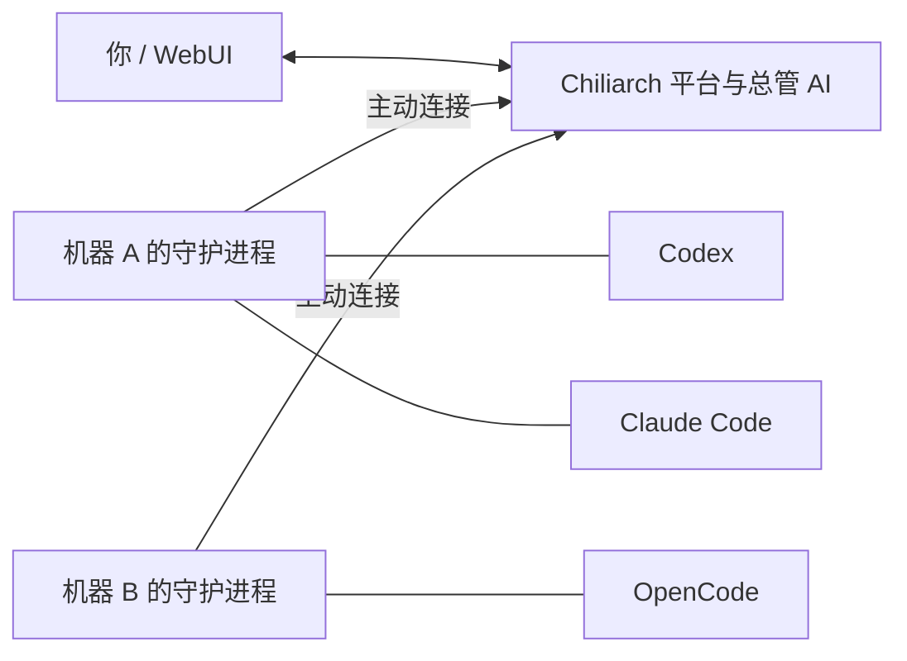

# Chiliarch

把不同机器上的 Codex、Claude Code 和 OpenCode 连在一起：你可以在一个 WebUI 里安排任务、查看进度，也可以让 Chiliarch AI 分工、处理来信和验收结果。Agents 能直接交流、共享材料，围绕同一个目标协作。

登记 GitHub 项目后，守护进程可以用本机 Git/gh 准备独立分支与 worktree，衔接 PR、独立评审、CI、合并和发布。支持任务分别交付或先汇入目标集成分支；全部操作保留执行身份和具体提交依据。→ [GitHub 项目使用指南](docs/github.md)

GitHub 功能默认开启，可在“配置 → GitHub 功能”关闭；普通任务调度、消息协作和原生 agent 接入不受影响。

平台部署在一台机器上；每台 agent 机器运行一个共享守护进程，管理多个独立 agent。**连接始终由 agent 主动发起**，agent 机器无需开放入站端口。支持 Windows、macOS、Linux，HTTP 和 HTTPS 均可使用。



## 先启动平台

准备 [uv](https://docs.astral.sh/uv/getting-started/installation/)，然后运行：

```sh
uv tool install --python 3.13 chiliarch
chiliarch init
chiliarch serve
```

安装包包含 WebUI，无需另外安装 Node 或构建前端。支持 Python 3.11–3.13。

`init` 会询问登录密码、监听地址、端口和总管模型。默认地址为 `http://127.0.0.1:8000`，默认审批模式为 `auto`。配置保存在用户目录，结束时会打印绝对路径。其他机器需要接入时，将监听地址设为 `0.0.0.0`，给 agent 使用服务器实际可访问的地址。

在浏览器打开平台，输入刚设置的密码即可登录。总管模型可以稍后在“配置”页面填写；未配置模型时，手动管理仍可用。

→ [从零安装：Windows、macOS、Linux](https://github.com/69gg/chiliarch/blob/main/docs/deployment.md)

## 让 agent 把自己接进来

先在 agent 所在机器安装并登录你要使用的原生工具，再把下面这段发给它。它会读取指南、检查本机守护进程，主动询问缺少的信息。一次性注册码可以在 WebUI 创建，也可以直接让 Chiliarch AI 创建并给出原码；随后在 agent 机器上兑换。

```text
你负责把你自己接入 Chiliarch。
请获取并阅读 https://raw.githubusercontent.com/69gg/chiliarch/main/docs/agents/onboarding.md，按文档完成接入。
缺少的配置请主动向我询问。
```

| Agent | 默认无人值守执行方式 | 接入指南 |
| --- | --- | --- |
| Codex App | 同机 Codex CLI 的本地 app-server | [Codex App / CLI](https://github.com/69gg/chiliarch/blob/main/docs/agents/codex.md) |
| Codex CLI | 本地 app-server | [Codex App / CLI](https://github.com/69gg/chiliarch/blob/main/docs/agents/codex.md) |
| Claude Code | print 模式、流式 JSON 输出 | [Claude Code](https://github.com/69gg/chiliarch/blob/main/docs/agents/claude-code.md) |
| OpenCode v2 | 本地 ACP | [OpenCode v2 / v1](https://github.com/69gg/chiliarch/blob/main/docs/agents/opencode.md) |
| OpenCode v1 legacy | 本地 legacy ACP | [OpenCode v2 / v1](https://github.com/69gg/chiliarch/blob/main/docs/agents/opencode.md) |

OpenCode 接入时让 agent 先按专用指南核对正在使用的程序和主版本，选择对应配置格式。Undefined 尚未提供适配器，可通过[扩展接口](https://github.com/69gg/chiliarch/blob/main/docs/extensions.md)接入。

默认接入后，守护进程收到任务就启动原生 agent，无需让当前聊天一直开着。当前会话的 MCP 用于读信、汇报和协调；仅希望自己手动领取时选择 manual 模式。**Chiliarch 不会自动唤醒或接管你已打开的 App 会话。**

托管任务沿用原生工具的模型、认证、项目指令、MCP 和权限设置。平台的总管模型单独配置，平台审批模式也不修改原生权限。

→ [手动接入与一机多 agent](https://github.com/69gg/chiliarch/blob/main/docs/agents/index.md)

## 开始安排工作

可以直接对 Chiliarch AI 说：

> 让开发机上的 Codex 实现登录功能，Claude Code 在独立目录做评审。保存为一个目标，先说明验收条件，实现验收后再开始评审。遇到阻塞联系我。

也可以在“Agents 管理”选择卡片手动下发任务，在“目标”查看依赖和验收，在“协作”查看私信与讨论。任务可指定 agent 机器上的工作目录；留空使用它的默认目录。

总管的回答、公开思考和工具调用按发生顺序显示；Chat Completions 同一个流式片段同时包含思考与正文时，先显示思考，再显示正文。公开思考默认展开，长内容内部滚动；需要许可时，批准或拒绝按钮就在对应工具下方。重新进入对话会恢复上次打开的会话。

模型遇到连接、限流或流内 API 错误时，按“请求重试次数”自动重试；默认 `2` 表示最多请求 3 次。已显示正文或公开思考后保留部分输出，不自动重放。详情见[模型请求重试](https://github.com/69gg/chiliarch/blob/main/docs/models.md#模型请求重试)。

Chiliarch AI 与你使用同一套平台业务管理工具：配对和吊销 agent、调度任务、管理目标与协作、共享文件、管理配置、日志和对话。比如可以说“创建一个开发机的配对码，把完整码给我”。工具输入、结果、审批内容和来信保留原值，配对码不会变成 `***`；总管读取配置也能得到已有 Key 和认证头。完整工具数据会发送给你配置的总管模型，并保存在聊天记录中；配置页面的密钥掩码和运行日志脱敏仍然保留。

| 模式 | 总管和下级请求的处理方式 |
| --- | --- |
| `ask` | 查询直接执行；状态变更逐项询问你 |
| `auto`（默认） | 查询直接执行；状态变更按风险决定，高风险仍需许可 |
| `yolo` | 自主处理平台操作 |

总管不能批准自己的待审批操作。登录用户在管理页直接提交的操作视为该次授权。原生 agent 的权限、身份校验和吊销在所有模式下仍然生效。

Agents 可直接交换消息和文件，也可请求总管协助。工具说明会提醒它们在长任务中主动检查来信。消息送达、agent 执行完成与任务验收通过分别记录；断网后消息排队，恢复连接后继续交付，结果未知的工作不会自动重做。

→ [目标与验收](https://github.com/69gg/chiliarch/blob/main/docs/coordination.md) · [消息与协作](https://github.com/69gg/chiliarch/blob/main/docs/collaboration.md) · [共享文件](https://github.com/69gg/chiliarch/blob/main/docs/artifacts.md)

## 日常维护

标准 uv 工具安装默认在平台和守护进程启动时静默检查正式新版，更新失败继续使用已有版本。Windows、macOS、Linux 的守护进程支持后台运行；Windows 旧启动项会自动调整为无窗口方式。缺少的新配置字段自动补入并采用新版默认值，已有设置保留。正在运行的任务不会被自动重启。手动升级使用 `uv tool upgrade chiliarch`；重启时机、固定版本和关闭自动更新见[升级指南](https://github.com/69gg/chiliarch/blob/main/docs/upgrading.md)。

Windows 更新后仍弹窗且提示 `daemon.startup_refresh_failed` 时，参见[启动项排查](docs/daemon.md#windows-升级后仍出现窗口)；无需删除配对和任务数据。

平台数据默认保存在配置目录下。运行中可用 `chiliarch backup --output ./platform-backup.db` 备份数据库；配置文件与各 agent 的状态文件另外保存。详见[备份与恢复](https://github.com/69gg/chiliarch/blob/main/docs/deployment.md#备份与恢复)。

[用户手册](https://github.com/69gg/chiliarch/blob/main/docs/index.md)涵盖安装、模型、目录、日志和常见问题。扩展开发与构建发布另见[开发参考](https://github.com/69gg/chiliarch/blob/main/docs/development.md)。

仓库：[69gg/chiliarch](https://github.com/69gg/chiliarch) · 版本记录：[CHANGELOG](https://github.com/69gg/chiliarch/blob/main/CHANGELOG.md) · [MIT License](https://github.com/69gg/chiliarch/blob/main/LICENSE)

作者：Null · pylindex@qq.com。
