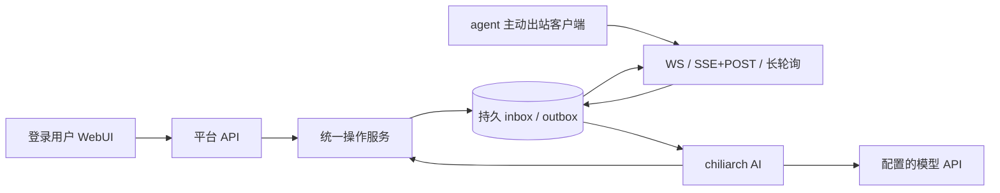

# 架构与保证边界

本文供理解内部实现和开发扩展时参考。日常使用从[用户手册](index.md)开始。

## 运行与数据流

chiliarch 是单服务进程的 ASGI 应用。FastAPI 提供浏览器 API 和 agent 传输入口；SQLite 保存注册身份、消息、任务、操作、审批、审计以及总管会话。SQLAlchemy 封装数据库访问，模型 SDK 只负责模型请求。

图中返回 agent 的消息始终使用它建立的连接或请求。平台没有 agent 地址拨号器、SSH 入口或反向回调。

核心模块：`protocol` 定义可移植协议；`database` 管理存储；`service` 提供操作与授权；`transport` 仅转换传输；`auth` 管理单用户会话和凭证摘要；`chat` 管理总管执行；`ai.providers` 转换模型 API，`ai.context` 管理 token 用量与跨 API 摘要压缩；`client` 提供出站传输与持久队列；`adapters` 复用客户端实现 MCP 会话桥与原生 CLI runner；`daemon` 管理本机独立 agent 的共享后台进程，`daemon_client` 和系统服务适配负责本地发现、健康与用户登录自启动；`config` 与 `logging` 管理运行配置和日志。

本机共享守护进程按当前系统用户登记多个 agent，每个身份保留独立状态库、凭证和平台出站连接。原生宿主启动轻量 stdio MCP 桥，通过受认证的回环接口向已有守护进程转发；常驻连接不意味着平台能唤醒空闲宿主会话。托管身份按机器本地 TOML 的程序、默认工作目录和资源限额运行：Codex 使用独立本机 app-server stdio，经过 `initialize`、`thread/start` 或 `thread/resume`、`turn/start`；Claude Code 使用 print JSONL；OpenCode v2 和 v1 legacy 使用 ACP stdio，经过 `initialize`、`session/new` 或 `session/load`、`session/prompt`，并由 `session/update` 接收流式事件。任务内 mailbox 只读写父连接的本地队列。平台不会反向联系 agent IP。

原生模型、provider、认证、沙箱、审批、指令、skills、hooks 与 MCP 由原生工具加载。runner 只为任务追加一个名称唯一的 mailbox MCP，提示模型使用该名称，不覆盖用户已有服务或为其自动授予工具权限。Codex 续接保留原生 resume 语义，可能沿用此前线程配置。app-server 不连接用户已有 App 控制 socket；当前也没有跨平台原生审批或用户输入回复桥，收到必须交互的请求时明确受阻或失败，不通过平台审批模式放宽原生权限。

安装先发现复用健康服务，再注册当前 agent；默认用户登录后自动启动，Windows、macOS、Linux 共用本地协议与业务逻辑，系统差异只在目录、服务管理和进程树控制。运行管理与目录说明见 [本机守护进程](daemon.md)。跨进程文件锁保证同一状态库只有一个网络连接所有者；legacy standalone MCP/独立 runner 仍可单独运行，但不能并行占用已登记状态。共享进程不共享平台凭证，不合并协议身份。

## 总管是一级参与者

总管有持久会话、运行状态、事件序列、待审批工具和下级来信 inbox。它可以查询、配对、派发、取消、联系 agent，管理项目配置、日志和对话。工具与 WebUI 业务操作共用 OperationService，不能通过绕过 HTTP 路由获得额外权限。

总管可以批准或拒绝下级请求，但状态变更受当前 ask/auto/yolo 模式约束。agent 消息只是一项请求或联系，不是管理员指令、系统提示词或用户批准。批准自己的待审批操作始终由登录用户完成。

同伴发现与已获授权的横向通信由操作服务直接处理，不依赖模型。需要总管判断的来信在未配置模型时持久保留待处理，用户仍可手动处理；配置模型后后台继续处理。浏览器断开不取消总管运行，重连按事件序列恢复显示。

目标、任务关联与协调事件分别保存于附加表；任务终态与协调待办同事务提交，不依赖进程内监听器必达。总管扫描待办，在原目标会话空闲后原子创建并关联运行；等待审批时保留新事件，重复终态不重复唤醒。下级携带的任务关联先验证所属身份。重启对中断协调创建状态核对轮次，不重放旧工具调用。`coordination` 管理依赖、验收和明确重试，`supervision` 管理会话路由、待办消费和恢复；它们沿用统一操作服务，见 [目标工作流](coordination.md)。

总管将完整消息/工具事件与活跃模型窗口分开持久保存：`chat_messages/chat_events` 保留用户可见历史及原始回放，`chat_runs.history` 保存当前可接续窗口，`chat_contexts` 保存每轮输入加输出的 token 测量基线。默认 200k 的窗口在 90% 时压缩；摘要请求不提供操作工具，等待审批的调用及其结果完整收集后才压缩。成功摘要与完成事件在同一个短事务提交，失败保留原窗口。下一次问答沿用最近完成运行的窗口，随后补入新消息；不会因为压缩而删除审计记录或重复执行工具。详细流程见 [模型行为](models.md#上下文窗口与自动压缩)。

## 持久投递与任务执行

- 消息拥有稳定 `id`，重试与切换传输不得生成新 ID。
- 入站去重键是 `(agent_id, message_id)`。同 ID 不同内容拒绝，不能当成“更新”。
- 保存消息及业务结果的事务提交后才 ACK。
- outbox 在 ACK 前可以重复交付；ACK 仅表示持久接收。
- 客户端出站与服务端 WS/SSE 下行按消息独立退避；通知只唤醒检查，不提前重投旧消息。连接内计时不修改持久状态，重连仍按原 ID 立即恢复。
- 任务身份独立于消息身份；状态报告不是 ACK。
- 排队、已交付、已接受、执行中、完成、失败、取消请求、取消、过期和中断分别表达不同事实。
- 取消是协作请求。已运行的 agent 没有确认取消之前，不能显示为确实停止。
- 取消或过期的排队命令不会在数日后重新上线时继续交付。
- 心跳是连接活性信号，不能堆积为离线业务队列。

保证范围是“持久消息的至少一次交付与幂等受理”，不是任意外部副作用恰好一次。客户端具有持久 inbox/outbox 和 task ledger；取消 tombstone 与取消意图在同一事务中保存，避免 ACK 后崩溃导致取消丢失；运行中任务停止并确认后才报告取消终态，取消确认前重启则报告中断与结果未知；领取任务和提交结果使用原子状态转换。进程执行中停机后，下次启动将未完成任务报告为 `interrupted`，不会盲目重新执行。普通网络断连不停止正在执行的工作。适配器必须提供同等保证，并说明外部工作的恢复能力。托管 runner 仅在原生成功终态和退出码共同确认后报告完成，超时、取消或输出超限会清理整个原生进程树（POSIX 进程组、Windows Job Object）。

## 事务与故障边界

SQLite 使用 WAL、外键和 busy timeout；写事务保持短小。初始化通过真实的 `BEGIN IMMEDIATE` 事务一次提交表、索引和 schema version，避免 sqlite3 默认事务模式将每条 DDL 单独落盘；失败时整体回滚，版本检查与建表共用数据库写锁。不改变普通业务事务的提交方式或持久性设置。单服务进程的写锁协调平台变更。客户端的单连接读写共用锁；传输切换或任务取消时，必须等待 SQLite 工作线程完成提交或回滚后才释放连接，不能把未提交的结果发送给平台或让下一次写入复用残留事务。自定义操作在事务锁外执行，并使用持久 reservation，避免持锁调用外部系统。进程中断后，结果未知的自定义副作用不能自动重做。

配置文件替换与数据库事务不构成跨资源原子事务。配置修改前先完整验证；替换文件为原子写入。数据库失败或进程中断后，应检查保存配置、当前生效版本和操作记录再决定是否重试。

初版不支持多个 Uvicorn workers、多节点一致性或跨 agent 全局顺序。数据库 URL 是可迁移边界，但当前正式验收对象为 SQLite；迁移到其他数据库时必须实际验证事务和方言行为。

## 数据与外部目的地

平台业务状态保存在配置指定的数据库，应用日志保存在配置指定的本地目录。参考客户端的凭证及收发状态保存在客户端自己的 SQLite 文件。

运行时对外模型请求由 `model.api_mode/base_url/headers/request_params` 决定。默认地址来自对应 SDK；设置 `base_url` 可覆盖。模型请求包含当前对话和必要工具结果，API Key 仅作为认证使用，公共配置读取和日志会脱敏。WebUI 静态资源、字体回退和 Markdown 渲染不依赖外部 CDN。

agent 机器上的 runner 复用 Codex/Claude Code/OpenCode 的原生认证、模型提供方和本地设置，原生模型流量由它们自身配置决定。Chiliarch 不读取原生认证文件或远程扫描历史会话；本地原生进程仍可能访问自身配置的工具与提供方。已原生登录且没有更高优先级 API 来源时，可由原生工具使用订阅，具体计费仍由服务商决定；usage 和费用估算不是扣费凭证。MCP mailbox 只通过已有父连接交换平台消息，不安装 agent 或建立服务端反向连接。

三系统自启动保存安装时的非秘密配置目录环境，帮助原生工具找到用户配置，不复制 API Key、不 source shell。现有健康进程复用不会自动取得新终端环境；服务定义与进程环境的更新步骤见 [守护进程环境](daemon.md#原生配置目录与环境)。

Agent 配对默认登记 managed runner，状态库旁的本地 TOML 保存每个身份的默认工作目录；manual 需显式选择。统一操作层校验任务可选 `workdir` 并协商客户端能力，审批、持久队列与依赖释放都保留该参数。服务端不解析或访问远端机器的实际路径，runner 在本机验证目录、解析实际路径并加锁，使用本轮目录启动原生工具。心跳分别报告默认目录与活动任务实际目录，协作等待据此检查资源冲突；续接绑定原生会话的实际目录，不随本机默认值变化。

标准 uv 工具安装的启动更新器会查询 PyPI 正式版本，并通过 uv 从 PyPI 下载兼容的二进制发行包及依赖（通常由 `files.pythonhosted.org` 分发）；不发送平台会话、任务、agent 凭证或原生认证。新版在独立私有运行环境完成安装和校验后，才原子发布后续启动的选择。检查或安装失败继续使用已验证版本；不会改写运行中代码、自动强停已有 daemon 或替换源码 checkout。平台与每台 agent 机器分别发起更新请求，自定义镜像或无法按原语义复用的复杂安装约束会保留人工维护方式；开关、版本约束和详细生效边界见 [自动升级](upgrading.md)。

本地 daemon API 的版本独立于软件发行版本。健康发现与调用按本地 API 兼容性判断，允许已更新 CLI 与仍在完成工作的兼容旧 daemon 共存；不健康或 API 不兼容时仍拒绝正常调用。平台与 agent 之间的公开消息协议继续由 `chiliarch.protocol` 单独管理。

开发安装与流水线会访问 Python/npm 包仓库，发布会访问 PyPI 与 GitHub。服务端不会联系 agent 所在机器的 IP。

## 横向通信与材料交付

`collaboration` 保存成员明确的讨论、可信来源消息、逐人回执、任务收件范围、续接上下文和等待关系。请求仍经 OperationService 校验、审批与持久去重，普通路由不必启动模型轮次。显式唤醒创建正常任务，使用已有agent出站通道，目录互斥及本地权限不变。`artifacts` 在 SQLite 中保存不可变清单和文件块，提供成员范围内的主动上传/下载；二进制传输工具不导出给总管，审计与可见请求会屏蔽块正文。

`monitoring` 为失联、进度停滞写入持久协调事件，不推断外部进程已停止。可恢复模型故障按预算退避产生新核查轮次，用户停止撤销待恢复。runner本地状态库记录平台创建的原生会话归属，只续接最近成功且确认停止的工作。详见[协作](collaboration.md)、[产物](artifacts.md)与[模型恢复](models.md)。
