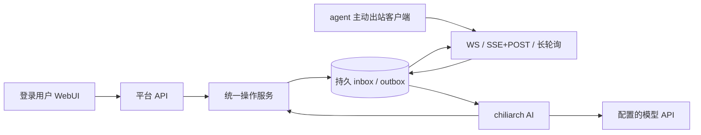

# 架构与保证边界

## 运行与数据流

chiliarch 是单服务进程的 ASGI 应用。FastAPI 提供浏览器 API 和 agent 传输入口；SQLite 保存注册身份、消息、任务、操作、审批、审计以及总管会话。SQLAlchemy 封装数据库访问，模型 SDK 只负责模型请求。

图中返回 agent 的消息始终使用它建立的连接或请求。平台没有 agent 地址拨号器、SSH 入口或反向回调。

核心模块：`protocol` 定义可移植协议；`database` 管理存储；`service` 提供操作与授权；`transport` 仅转换传输；`auth` 管理单用户会话和凭证摘要；`chat` 管理总管执行；`ai.providers` 转换模型 API；`client` 提供出站传输与持久队列；`adapters` 复用客户端实现 MCP 会话桥与原生 CLI runner；`config` 与 `logging` 管理运行配置和日志。

MCP 的 standalone 模式由原生宿主启动 stdio 子进程，该进程主动连接平台；宿主会话通过工具领取工作。托管 runner 在相同机器上主动连接平台，并按固定本地配置启动 Codex CLI/Claude Code；子任务的 MCP mailbox 只读写本地队列，由父连接传输。跨进程文件锁保证同一个状态库只有一个连接所有者。平台不会远程启动或唤醒 Codex App 会话。

## 总管是一级参与者

总管有持久会话、运行状态、事件序列、待审批工具和下级来信 inbox。它可以查询、配对、派发、取消、联系 agent，管理项目配置、日志和对话。工具与 WebUI 业务操作共用 OperationService，不能通过绕过 HTTP 路由获得额外权限。

总管可以批准或拒绝下级请求，但状态变更受当前 ask/auto/yolo 模式约束。agent 消息只是一项请求或联系，不是管理员指令、系统提示词或用户批准。批准自己的待审批操作始终由登录用户完成。

未配置模型时，下级来信持久保留待处理，用户仍可手动处理；配置模型后后台继续处理。浏览器断开不取消总管运行，重连按事件序列恢复显示。

## 持久投递与任务执行

- 消息拥有稳定 `id`，重试与切换传输不得生成新 ID。
- 入站去重键是 `(agent_id, message_id)`。同 ID 不同内容拒绝，不能当成“更新”。
- 保存消息及业务结果的事务提交后才 ACK。
- outbox 在 ACK 前可以重复交付；ACK 仅表示持久接收。
- 任务身份独立于消息身份；状态报告不是 ACK。
- 排队、已交付、已接受、执行中、完成、失败、取消请求、取消、过期和中断分别表达不同事实。
- 取消是协作请求。已运行的 agent 没有确认取消之前，不能显示为确实停止。
- 取消或过期的排队命令不会在数日后重新上线时继续交付。
- 心跳是连接活性信号，不能堆积为离线业务队列。

保证范围是“持久消息的至少一次交付与幂等受理”，不是任意外部副作用恰好一次。客户端具有持久 inbox/outbox 和 task ledger；取消 tombstone 与取消意图在同一事务中保存，避免 ACK 后崩溃导致取消丢失；运行中任务停止并确认后才报告取消终态，取消确认前重启则报告中断与结果未知；领取任务和提交结果使用原子状态转换。进程执行中停机后，下次启动将未完成任务报告为 `interrupted`，不会盲目重新执行。普通网络断连不停止正在执行的工作。适配器必须提供同等保证，并说明外部工作的恢复能力。托管 runner 仅在原生成功终态和退出码共同确认后报告完成，超时、取消或输出超限会清理整个原生进程组。

## 事务与故障边界

SQLite 使用 WAL、外键和 busy timeout；写事务保持短小。单服务进程的写锁协调平台变更。自定义操作在事务锁外执行，并使用持久 reservation，避免持锁调用外部系统。进程中断后，结果未知的自定义副作用不能自动重做。

配置文件替换与数据库事务不构成跨资源原子事务。配置修改前先完整验证；替换文件为原子写入。数据库失败或进程中断后，应检查保存配置、当前生效版本和操作记录再决定是否重试。

初版不支持多个 Uvicorn workers、多节点一致性或跨 agent 全局顺序。数据库 URL 是可迁移边界，但当前正式验收对象为 SQLite；迁移到其他数据库时必须实际验证事务和方言行为。

## 数据与外部目的地

平台业务状态保存在配置指定的数据库，应用日志保存在配置指定的本地目录。参考客户端的凭证及收发状态保存在客户端自己的 SQLite 文件。

运行时对外模型请求由 `model.api_mode/base_url/headers/request_params` 决定。默认地址来自对应 SDK；设置 `base_url` 可覆盖。模型请求包含当前对话和必要工具结果，API Key 仅作为认证使用，公共配置读取和日志会脱敏。WebUI 静态资源、字体回退和 Markdown 渲染不依赖外部 CDN。

agent 机器上的 CLI runner 复用 Codex/Claude Code 的原生认证、模型提供方和本地设置，原生模型流量由它们自身配置决定。Chiliarch 不读取原生认证文件或远程扫描历史会话；本地原生进程仍可能访问自身配置的工具与提供方。MCP mailbox 只通过已有父连接交换平台消息，不安装 agent 或建立服务端反向连接。

开发安装与流水线会访问 Python/npm 包仓库，发布会访问 PyPI 与 GitHub。服务端不会联系 agent 所在机器的 IP。
