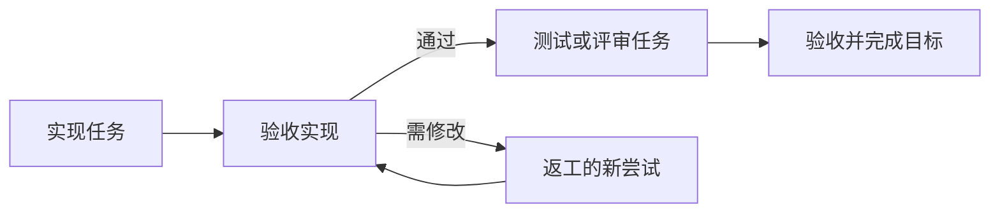

# 目标、任务与验收

一项长期工作可以保存为“目标”，再分给不同 agents。任务记录具体执行，验收记录结果是否符合要求；关闭网页或重启平台后仍能查看。

## 建立第一项协作目标

在“目标”页面创建，或直接对 Chiliarch AI 说：

> 建立“登录功能”目标。Codex 实现，Claude Code 在独立目录评审。要求密码验证、退出登录和错误提示都有测试。先验收实现，再开始评审，发现问题安排返工。

为目标写清楚工作内容、约束和验收条件。给每项任务选择 agent、指令、可选工作目录与前置任务。工作目录是 **agent 机器上的已有绝对路径**，留空使用其默认目录。

前置任务执行完成且验收通过，后续任务才会派发。仅有“执行完成”还不会释放依赖。

## 查看进展

目标列表可以搜索名称、说明与任务内容，按状态筛选，或只看需要处理的工作。进入详情查看任务、历史尝试、验收说明和产物。

| 提示 | 意味着什么 | 接下来 |
| --- | --- | --- |
| 等待前置任务 | 依赖尚未验收通过 | 处理前置工作与验收 |
| Agent 离线 | 近期没有心跳 | 在对应机器检查连接；不直接当作已停止 |
| 等待领取 | Manual 会话还未领取 | 让当前会话主动领取，或改为托管执行 |
| 执行器受阻 | 目录占用、未确认旧进程等 | 按 agent 详情指引检查本机 |
| 待验收 | Agent 已报告执行完成 | 检查交付、测试与限制，批准或要求修改 |
| 待返工 | 验收要求修改，或最新尝试失败 | 核对实际结果后重试 |
| 待请求 / 待许可 | 协作申请或审批尚未处理 | 在相应位置处理 |

历史失败不会重复算成当前故障，但仍可查看。只有所有当前任务验收通过，且没有相关未处理申请或派发许可，目标才能完成。

## 验收交付

查看 agent 结果里的完成内容、验证、产物和限制。必要时让另一个 agent 独立评审；进程退出成功本身不能证明符合业务要求。

验收有两种决定：

- **通过**：记录理由与可访问产物，后续依赖可以继续。
- **要求修改**：说明缺什么，再用重试创建新的尝试。

产物可以是 commit、PR、报告或共享文件引用。平台保存引用，不自动访问 agent 的本地文件。跨机器使用双方可访问的仓库，或[上传共享文件](artifacts.md)；单独给出本机路径不会传输内容。

已通过验收的结果不能直接改回“要求修改”，后续任务可能已开始；需要撤回时明确处理后续任务，再建立跟进工作。

## 返工、重试与换人接手

在任务重试入口选择原 agent 或另一位接手者，并填写**恢复说明**：检查了哪些改动与结果、旧工作是否停止、下一轮该怎样继续。

例如：

> 已检查提交和工作目录，旧进程已停止。登录实现保留，只补齐错误提示与回归测试；测试通过后提交评审。

新尝试保留原目标、验收条件、依赖与历史记录。下游自动检查重试链的最新尝试，不需改掉原来的依赖。换 agent 时传递结果、评审、产物与恢复说明，但不会自动复制项目目录。

同身份重试默认沿用前次实际 / 指定目录；换身份默认使用对方目录，可另行指定。旧工作仍在执行或取消尚未确认时，不能直接转交。不要另建无关任务来掩盖原失败工作。

### 续接与重试怎样选

| 你想做什么 | 使用方式 |
| --- | --- |
| 最近一次成功工作后继续同一原生会话 | `dispatch_task` 的 `continue_task_id` |
| 失败、中断或验收要求修改后再尝试 | `retry_task`，填写恢复说明 |
| 新项目或独立工作 | 新任务，不续接旧会话 |

续接只允许同身份、同适配器、同目录且已确认停止的最近成功托管任务。失败或未知结果不能借更早成功记录继续。用户手动创建的原生会话不被接管。

## 总管怎样继续协调

任务完成、失败、中断等事件会持久通知总管。总管核对验收、安排下一项任务并汇总；任务相关来信回到原目标对话。会话忙碌或等待许可时，后来事件排队。

任务默认 300 秒没有更新，或 agent 超过离线阈值时，也会请求总管核查。这不认定任务失败，也不自动重派未知工作。

临时模型故障可以按配置退避核查。模型未配置时先保留事件；用户停止总管或不可恢复失败后，自动协调暂停。发新消息或在目标页面点击“继续协调”恢复，普通修改标题不表示恢复。

## 暂停、取消与中断

- 将目标设为 `blocked`，暂停释放未派发任务；已经运行的工作继续。改回 `active` 后重新检查依赖。
- 取消目标，会取消未完成任务并撤回相关未执行许可。已运行或离线的任务仍需要客户端确认停止。
- 停止总管对话，只停止总管这轮协调，不等于取消所有 agents 的任务。
- 服务重启会核对中断轮次的实际任务和操作结果，不重放旧工具，也不自动重做原生工作。

结果未知时，先检查本地改动、进程和原生记录，再决定继续或重试。取消请求、失联或吊销都不能单独证明旧进程已经停止。

## 对应的总管工具

总管使用 `create_goal`、`list_goals`、`get_goal`、`update_goal` 管理目标，用 `dispatch_task` 下发，用 `review_task` 验收，用 `retry_task` 返工或交接。它与管理页面经过相同的参数与审批检查。

Agent 可通过 `request_operation` 申请这些工作，由平台按模式处理，不能自己验收自己的结果。ask 审批状态变更，auto 按风险决定，重试等高风险仍需许可。总管不能批准自己的待审批操作。

[消息与协作](collaboration.md) · [工作目录](agents/index.md#默认目录与任务目录) · [总管模型](models.md)。
