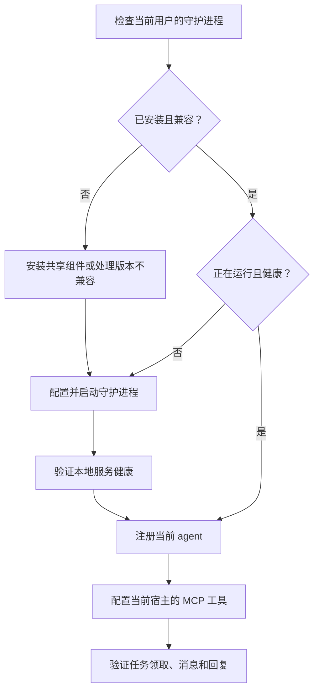

# 跨平台守护进程设计

本文记录已确定的接入与运行要求，作为守护进程的实现依据。当前代码提供 MCP 会话桥和单个 CLI runner，尚未提供本节描述的统一安装入口、多 agent 守护进程或系统自启动管理；现有托管 runner 仍依赖 POSIX 进程组，不能据此宣称已支持 Windows 托管执行。

## 安装顺序

agent 自助接入和用户手动安装必须进入同一套检查流程，顺序如下：

已有健康守护进程直接复用；已安装但未运行时启动已有服务；没有安装时先安装共享组件。版本不兼容时明确报告兼容要求，升级时保留凭证、任务和其他 agent 的配置。守护进程没有通过本地健康检查前，不能宣称 agent 已接入。

守护进程和 MCP 桥由同一个 `chiliarch` 包提供，Python 继续使用 uv 管理。共享组件只安装一份，后续 agent 添加自己的登记、工作目录、执行策略和宿主 MCP 配置，不重新配对已有 agent 或覆盖其配置。这里的复用不合并各 agent 的平台身份：首版仍保留各自身份和队列，新 agent 按自己的身份完成配对，由守护进程统一管理其出站连接。

使用持久的 uv 工具安装环境，系统启动配置记录实际可执行程序的绝对路径。临时执行环境、安装时的 shell PATH 和当前项目目录不能成为后台服务的隐式依赖。[uv 工具管理文档](https://docs.astral.sh/uv/concepts/tools/)

检查守护进程时验证本地接口、程序版本、协议兼容性、运行用户和健康状态。PID 文件、端口被占用或系统启动项存在都不足以证明服务可用。多个 agent 同时安装时，通过单实例锁和原子注册保证不会启动重复服务。

## 默认在用户登录后启动

默认方式已经确定为：**当前系统用户登录后自动启动**。守护进程使用该用户的权限、目录和既有原生 agent 环境，安装完成后也可以立即启动，无需等待下次登录。

| 系统 | 默认管理方式 | 运行身份 |
| --- | --- | --- |
| Windows | 任务计划程序，绑定当前用户的登录触发器与交互登录令牌 | 当前用户，普通权限 |
| macOS | 当前用户的 LaunchAgent，由 launchd 管理 | 当前用户 |
| Linux | 可用时使用 systemd 用户服务 | 当前用户 |

Windows 登录任务采用明确的用户绑定，不注册为“任意用户登录”触发，不默认以 SYSTEM 运行；任务配置要允许长期运行，并明确电池、休眠恢复和失败重启行为。[Windows 任务计划文档](https://learn.microsoft.com/en-us/windows-server/administration/windows-commands/schtasks-create)

macOS 的用户服务使用用户 `Library/LaunchAgents` 目录，配置完整启动参数和日志位置。[Apple LaunchAgent 文档](https://developer.apple.com/library/archive/documentation/MacOSX/Conceptual/BPSystemStartup/Chapters/CreatingLaunchdJobs.html)

Linux 检测 systemd 用户管理器是否实际可用，再写入用户服务配置；默认不启用让用户服务在未登录时运行的 linger。用户配置遵循 XDG 目录约定。[systemd 用户单元路径](https://github.com/systemd/systemd/blob/main/man/systemd.unit.xml)

系统管理器不可用、环境禁止注册启动项，或运行在没有登录会话的容器中时，仍提供同一个前台运行入口，可交给已有进程管理器管理。诊断明确区分“可手动运行”和“已经注册自启动”，不能静默假装成功。系统启动后、用户未登录时运行作为另外的显式配置，不改变默认行为。

## 灵活运行与本地边界

默认每个系统用户运行一个守护进程；同一机器上不同用户的凭证、消息和 agent 配置分别管理。每个 agent 保留独立编号、工作目录、任务归属、权限策略和并发限制，同类型 agent 也可登记多个实例。

共享运行逻辑处理平台出站连接、重连、持久队列、agent 登记与任务路由。系统差异集中在用户目录、服务管理与原生进程控制三个适配位置。所有平台共用本地通信协议，可以通过回环地址服务连接；现有 stdio MCP 宿主使用轻量桥接进程转发。接口仅供本机使用，注册与调用绑定实际 agent 身份，长期平台凭证由守护进程管理，不作为 MCP 工具结果返回。

路径、监听端口、原生可执行程序与模型设置可配置；默认值按运行平台和当前用户解析，不能硬编码开发机器路径。后台进程显式设置工作目录和必要环境，支持含空格、中文的路径。

所有到 Chiliarch 平台的连接仍由本机守护进程主动出站发起，保留 WS → SSE＋POST → 长轮询降级。平台不能反向连接本机。将多个逻辑身份合并到一条物理连接，需要另行定义协议中的身份与授权边界，不直接共用一个 agent 的任务身份。

MCP 会话主动调用工具领取任务和联系总管；守护进程托管执行时启动本机 CLI。MCP 连接本身不保证唤醒空闲的 Codex App。是否允许托管执行、使用哪个工作目录以及允许哪些原生工具，由机器本地配置决定。

## Windows、macOS、Linux 的完整支持

三种系统都需要完成安装、发现、共享守护进程、MCP 接入、托管 CLI 执行、取消和退出清理，不能只把“能连接 MCP”标成完整支持。

现有 Linux/macOS runner 的进程组管理继续复用。Windows 增加原生进程树管理，例如通过 Job Object 管理任务及其后代，并在取消、超时、退出时完成整组清理；不能只结束最外层 CLI 进程。[Windows Job Objects](https://learn.microsoft.com/en-us/windows/win32/procthread/job-objects)

原生进程退出码和成功终态共同决定任务完成；取消需要确认实际停止。服务崩溃后，结果未知的工作保持中断状态，不因自启动或自动重启而重新执行。普通网络断线继续使用已有持久队列，不重复启动任务。休眠恢复后重新建立连接，并核对已经执行任务的状态。

运行管理提供安装、启动、停止、重启、状态、日志、启用/禁用自启动和卸载入口。卸载当前 agent 只移除该实例；其他 agent 仍在使用时保留共享服务，删除守护进程与清理持久状态是明确的独立操作。升级在任务安全停止或排空后替换程序，继续复用原有状态。

## 验收要求

- Windows、macOS、Linux 原生 CI 覆盖 Python 3.11–3.13；不能用 Linux mock 代替 Windows 进程清理验收。
- 安装入口验证全新安装、健康服务复用、已有服务未运行、版本不兼容和多个 agent 同时安装；保护已有凭证与配置。
- 两个 agent 同时运行时任务、取消、消息和结果不能串线；独立限制并发。
- 使用测试子进程验证成功、失败、取消、超时、服务退出及后代清理，不调用真实厂商推理做自动验收。
- 三种系统分别验证自启动配置的注册、查询、禁用和移除；登录后实际启动另做原生会话验收，不凭配置文件存在宣称已启动。
- 验证后台 PATH、含空格和中文的路径、端口冲突、休眠恢复、网络重连、崩溃恢复和日志轮换。
- agent 自助接入指南与用户安装文档同步采用“检查守护进程 → 安装或复用 → 健康检查 → 注册当前 agent → 配置 MCP”的流程。
